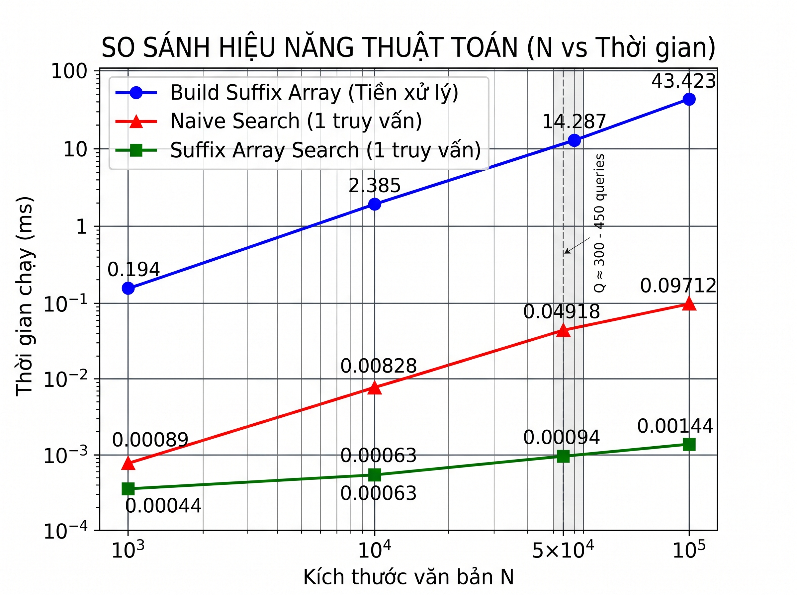

# Đồ án Cấu trúc Dữ liệu & Thuật toán: Suffix Array Pattern Search

**Nhóm thực hiện:**
1. Nguyễn Lê Hảo - 25110019
2. Ngô Thị Minh Thư - 25110062

---

## 1. Giới thiệu dự án
Đồ án này tập trung cài đặt và đánh giá hiệu năng của cấu trúc dữ liệu **Suffix Array** trong bài toán tìm kiếm chuỗi mẫu chính xác (Exact Pattern Matching). Dự án so sánh trực tiếp tốc độ giữa phương pháp tìm kiếm nhị phân trên Suffix Array và phương pháp tìm kiếm truyền thống (Naive Search) trên văn bản lớn.

**Các kỹ thuật áp dụng:**
- Xây dựng Suffix Array bằng thuật toán **Prefix Doubling** với độ phức tạp $O(n \log^2 n)$.
- Tìm kiếm mẫu (Pattern) bằng **Binary Search** với độ phức tạp $O(m \log n)$.
- Quản lý bộ nhớ hoàn toàn bằng thư viện C++ STL (`std::vector`, `std::string`).

---

## 2. Cấu trúc thư mục và Hướng dẫn chạy

### Cấu trúc mã nguồn
- `src/main.cpp`: Entry point, chứa Menu tương tác và logic Benchmarking/Demo.
- `src/suffix_array.cpp` / `.h`: Module tiền xử lý và xây dựng mảng hậu tố.
- `src/pattern_search.cpp` / `.h`: Module chứa các thuật toán tìm kiếm (Binary Search & Naive Search).
- `data/large_text.txt`: File văn bản dùng để test hiệu năng và tải trọng.

### Cách biên dịch và chạy (Terminal)
Sử dụng compiler `g++` để biên dịch các module:
```bash
g++ main.cpp suffix_array.cpp pattern_search.cpp -o dsa_project -O3
```
Chạy chương trình:
```bash
# Trên Windows:
.\dsa_project.exe
# Trên Linux/Mac:
./dsa_project
```
Hệ thống cung cấp Menu 3 chức năng: Kiểm tra tính đúng đắn (Small Test), Đo lường điểm giao thoa đa cấp độ (Benchmark), và Demo đối chiếu tốc độ trực tiếp (Live Demo).

---

## 3. Giải trình kỹ thuật

### Về việc không sử dụng mảng LCP (Longest Common Prefix)
Trong đồ án này, nhóm quyết định **không cài đặt mảng LCP**. Lý do cụ thể như sau:
1. **Phù hợp với mục tiêu bài toán:** Yêu cầu cốt lõi của đồ án là tìm kiếm chuỗi mẫu chính xác (Exact Pattern Matching). Việc sử dụng cấu trúc Suffix Array kết hợp với thuật toán Tìm kiếm nhị phân (Binary Search) đã giải quyết trọn vẹn bài toán này với độ phức tạp tối ưu là $O(m \log n)$.
2. **Tối ưu tài nguyên bộ nhớ:** Mảng LCP chỉ nên được áp dụng ở các bài toán phức tạp hơn (như tìm chuỗi con lặp lại dài nhất). Đối với bài toán tìm kiếm mẫu cơ bản, việc khởi tạo thêm cấu trúc LCP sẽ làm tăng độ phức tạp không gian lưu trữ và thời gian tiền xử lý một cách dư thừa.
3. **Đánh giá về số lượng truy vấn (Queries):** Số lượng **2000 queries** hiện tại trong hàm test là **hoàn toàn đủ** để ép thuật toán bộc lộ khoảng cách hiệu năng. Dựa trên số liệu đo lường, điểm Crossover Point chỉ rơi vào khoảng 300 - 450 queries, do đó 2000 queries dư sức chứng minh Suffix Array vượt trội hoàn toàn so với Naive Search.

---

## 4. Đánh giá hiệu năng: Thực tế đo lường so với Lý thuyết Big-O

Dưới đây là bảng số liệu đo lường thực tế trên văn bản `large_text.txt` với 200 truy vấn ngẫu nhiên, độ dài pattern (m) từ 5-20 ký tự:

| Kích thước văn bản (N) | Thời gian Build SA (ms) | Thời gian 1 Query SA (ms) | Thời gian 1 Query Naive (ms) |
| :--- | :--- | :--- | :--- |
| 10,000 | 2.385 | 0.00063 | 0.00828 |
| 50,000 | 14.287 | 0.00094 | 0.04918 |
| 100,000 | 43.423 | 0.00144 | 0.09712 |

### Phân tích đối chiếu:
1. **Giai đoạn tiền xử lý (Build Suffix Array): Lý thuyết $O(n \log^2 n)$**
   - Khi $N$ tăng gấp 10 lần (từ 10,000 lên 100,000), thời gian tạo mảng SA tăng từ 2.385 ms lên 43.423 ms (tăng khoảng ~18 lần).
   - Điều này hoàn toàn khớp với lý thuyết hàm tuyến tính - logarit $O(n \log^2 n)$. Hàm tăng nhanh hơn tuyến tính ($O(n)$) một chút, nhưng vẫn tối ưu và có thể chấp nhận được để chuẩn bị cho quá trình tìm kiếm.

2. **Giai đoạn truy vấn (Query): Suffix Array $O(m \log n)$ vs Naive Search $O(n \times m)$**
   - **Với Naive Search:** Độ phức tạp phụ thuộc tuyến tính vào $N$. Thực tế cho thấy khi $N$ tăng 10 lần (10k -> 100k), thời gian tìm kiếm cũng tăng tỷ lệ thuận hơn 11 lần (từ 0.00828 ms lên 0.09712 ms).
   - **Với Suffix Array:** Độ phức tạp chỉ phụ thuộc vào thuật toán Binary Search $O(m \log n)$. Vì $\log n$ tăng trưởng cực kỳ chậm, nên dù văn bản $N$ tăng gấp 10 lần, thời gian tìm 1 mẫu gần như **không đổi** (chỉ nhích nhẹ từ 0.00063 ms lên 0.00144 ms). 
   - **Kết luận:** Tốc độ truy vấn của Suffix Array nhanh hơn Naive Search xấp xỉ **67 lần** tại mốc N = 100,000, chứng minh rõ ràng giá trị của việc đầu tư thời gian vào giai đoạn tiền xử lý.

---

## 5. Biểu đồ Crossover Point

